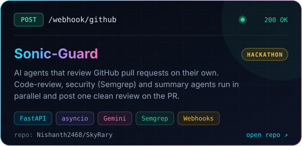
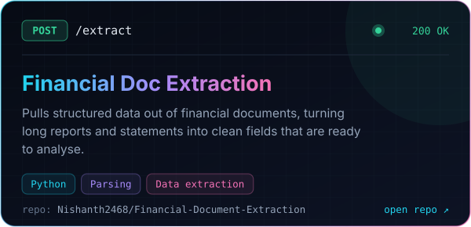
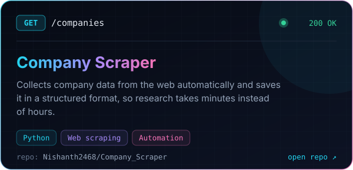
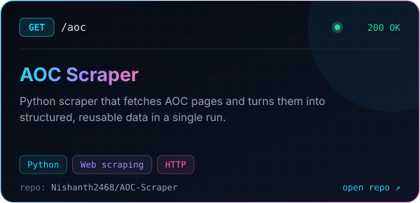
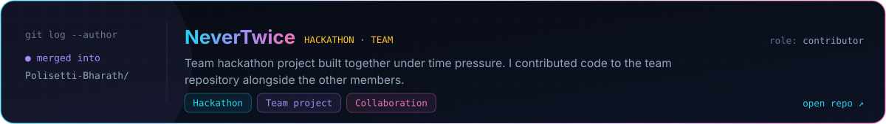

<!--
  Profile README for github.com/Nishanth2468
  ─ Edit projects / section titles in profile.json (the cards rebuild automatically).
  ─ Edit the text sections (about, stack, now, connect) right here.
-->

<div align="center">



<br/>


</div>

<br/>


> I'm a third-year CS student who learns backend by **building real things**: break them, read the docs, fix them, ship again.

- 🎓 &nbsp;**3rd-year Computer Science** student in India
- 🤖 &nbsp;Built an **AI pull-request reviewer** at a hackathon: FastAPI + three AI agents running in parallel
- 🕸️ &nbsp;Into **automating boring work**: scrapers, data extraction, small pipelines
- ☕ &nbsp;**DSA in Java**, projects in **Python**
- 🧭 &nbsp;Goal: **Python Backend Engineer**, starting in India and later working abroad

<br/>


<p align="center">
  
</p>

```toml
[project]
name            = "nishanth"
version         = "3.0.0-student"
requires-python = ">=3.11"

[tool.stack]
languages = ["Python", "Java", "C", "SQL"]
backend   = ["FastAPI", "REST APIs", "async / await", "Webhooks"]
ai        = ["Gemini API", "Claude API", "multi-agent pipelines"]
tooling   = ["Git", "Linux", "Docker", "VS Code"]
next      = ["PostgreSQL", "Redis", "caching", "system design"]
```

<br/>


<p align="center">
  <a href="https://github.com/Nishanth2468/SkyRary"></a>&nbsp;
  <a href="https://github.com/Nishanth2468/Financial-Document-Extraction"></a>
</p>
<p align="center">
  <a href="https://github.com/Nishanth2468/Company_Scraper"></a>&nbsp;
  <a href="https://github.com/Nishanth2468/AOC-Scraper"></a>
</p>
<p align="center">
  <a href="https://github.com/Polisetti-Bharath/NeverTwice"></a>
</p>

<br/>



<p align="center">
  
</p>
<p align="center">
  
</p>

<br/>


```diff
+ building    a URL shortener from scratch, one version at a time
+ practising  DSA in Java: arrays · hashing · sliding window
+ learning    how real backends handle databases, caching and scale
+ preparing   for open-source contributions in 2027
- copying     tutorials without understanding them
```

<br/>



<p align="center">
  <a href="https://www.linkedin.com/in/YOUR-LINKEDIN/"></a>
  <a href="https://x.com/YOUR-X-HANDLE"></a>
  <a href="https://leetcode.com/u/YOUR-LEETCODE/"></a>
  <a href="https://www.codechef.com/users/YOUR-CODECHEF"></a>
</p>

<details>
<summary><sub>⚙️ how this profile works</sub></summary>
<br/>

This README is a small pipeline. A GitHub Action runs every day and calls the GitHub GraphQL API. A Python script (`scripts/build_profile.py`, standard library only) turns the response into the SVG cards above and commits them back to the repo. There's no third-party stats server to go down, and every card is drawn from scratch.

</details>


